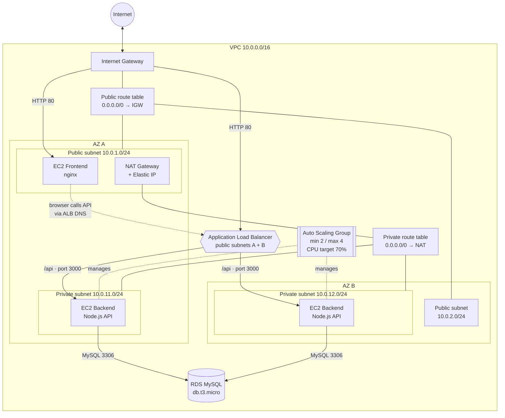
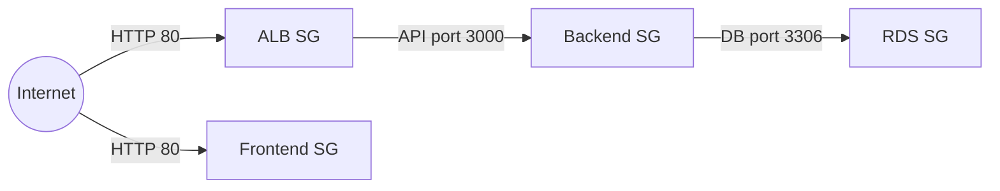
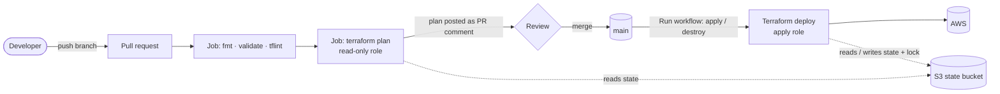

# AWS Highly-Available Full-Stack Deployment with Terraform

Deploying a full-stack web application on AWS using Terraform: custom VPC,
load balancing, auto scaling and a managed database.

🚧 **Work in progress**: the infrastructure is being built step by step.

## Roadmap

- [x] Networking (VPC, subnets, gateways)
- [x] Security groups
- [x] Database (RDS)
- [x] Backend (EC2, Auto Scaling, Load Balancer)
- [x] Frontend
- [x] CI pipeline (GitHub Actions): `fmt`, `validate` and `tflint` on every pull request
- [x] `terraform plan` on every pull request, authenticated to AWS with OIDC
- [x] Remote state in S3 and manual apply / destroy workflow
- [ ] End-to-end deployment and resilience demo

## Architecture (current state)

## Network design

| Subnet | AZ | CIDR | Routing |
|---|---|---|---|
| Public 1 | A | 10.0.1.0/24 | Internet Gateway |
| Public 2 | B | 10.0.2.0/24 | Internet Gateway |
| Private 1 | A | 10.0.11.0/24 | NAT Gateway (outbound only) |
| Private 2 | B | 10.0.12.0/24 | NAT Gateway (outbound only) |

A single NAT Gateway is used to keep costs low; a production setup would use one per AZ.

## Security design

Security groups are chained by **security group reference** rather than IP ranges:
each layer only accepts traffic from the layer directly in front of it.

| Security group | Inbound | Source |
|---|---|---|
| ALB | TCP 80 | `0.0.0.0/0` |
| Backend | TCP 3000 (API) | ALB security group only |
| RDS | TCP 3306 (MySQL) | Backend security group only |
| Frontend | TCP 80 | `0.0.0.0/0` |

- No SSH is opened anywhere: instances are administered through **AWS Systems Manager Session Manager**.
- The database has no outbound rule, as it never needs to initiate connections.

## Database

- **Amazon RDS for MySQL 8.0**, `db.t3.micro`, 20 GB gp3 storage
- Deployed in a **DB subnet group** spanning both private subnets
- `publicly_accessible = false`: the database has no public endpoint
- Single-AZ to limit costs (Multi-AZ would be enabled in production)

### Secrets handling

The master password is **generated and rotated by RDS** and stored in **AWS Secrets Manager**
(`manage_master_user_password = true`). Nobody chooses or sees it: it never appears in the code,
the Terraform variables, the Terraform state or the instance user data.

At startup, the API reads the secret with the **IAM role of its instance**, which is allowed to read
this secret only (`secretsmanager:GetSecretValue` on its ARN). If RDS rotates the password,
the API reloads the secret and reconnects.

## Backend

### Application

A minimal **Node.js / Express** REST API (`backend/`) backed by MySQL:

| Endpoint | Description |
|---|---|
| `GET /health` | Health check (returns `200 OK`) |
| `GET /api/messages` | List messages |
| `POST /api/messages` | Create a message (`{ "content": "..." }`) |

All connection settings are read from environment variables: no secret lives in the code.

### Compute

- **Launch Template**: Ubuntu 24.04 LTS, `t3.micro`, backend security group, IAM instance profile for SSM
- **User Data** (rendered with Terraform `templatefile()`): installs Node.js, clones this repository,
  installs dependencies and runs the API as a **systemd service** (auto-restart, starts on boot)
- **Auto Scaling Group**: min 2 / desired 2 / max 4 instances, spread across both private subnets

Every new instance bootstraps itself: no manual SSH or configuration is ever needed.

### Load balancing and resilience

- **Application Load Balancer** across both public subnets, listening on HTTP 80
- **Target Group** forwarding to the API on port 3000, with a health check on `GET /health`
- The ASG uses **ELB health checks**: an instance whose API stops answering is
  automatically terminated and replaced (self-healing)
- **Target-tracking scaling policy**: the ASG scales out when average CPU exceeds 70 %
  and scales back in when load drops, always between 2 and 4 instances

Users never reach the backend instances directly: all traffic goes
**Internet → ALB → Target Group → EC2**.

## Frontend

- Static **HTML / JavaScript** guestbook (`frontend/`) served by **nginx**
  on an EC2 instance in a public subnet
- Bootstrapped by User Data: installs nginx, clones this repository and copies the static files
- At boot, a `config.js` file is generated with the **ALB DNS name** injected by Terraform:
  the browser always calls the API through the load balancer, never a backend IP
- Administered through SSM Session Manager (no SSH port open)

## CI/CD

### Development workflow

- `main` is protected: changes are only merged through **pull requests**,
  one short-lived branch per topic (`ci/...`, `feat/...`, `docs/...`), deleted after merge
- Every pull request runs two **required checks**:
  1. **Format, validate and lint**: `terraform fmt -check`, `terraform validate`, `tflint` (AWS ruleset)
  2. **Terraform plan**: the full plan is posted as a comment on the pull request for review

### Authentication: OIDC, no stored AWS keys

GitHub Actions authenticates to AWS with **OpenID Connect**: each run receives
short-lived credentials (1 hour) by assuming an IAM role. No access key is stored in GitHub.

| IAM role | Used by | Permissions | Trust condition |
|---|---|---|---|
| `github-actions-terraform-plan` | pull request plans | `ReadOnlyAccess` | this repository only |
| `github-actions-terraform-apply` | manual deployments | `AdministratorAccess` | this repository, **`main` branch only** |

Trust policies match GitHub's OIDC `sub` claim, which includes the immutable owner and
repository IDs (`repo:<owner>@<id>/<repo>@<id>:...`): a renamed or re-created repository
with the same name cannot assume the roles.

### Remote state

- Terraform state is stored in an **S3 bucket** (versioned, encrypted, public access blocked)
- **Native S3 locking** (`use_lockfile`) prevents two runs from modifying the state at the same time
- Pull request plans are read-only and run with `-lock=false`

### Deployment

Deployments are **manual**, from the **Actions** tab → **Terraform deploy** → **Run workflow**:

1. choose `apply` or `destroy`
2. type the action name again to confirm
3. after `apply`, the frontend URL and the ALB DNS name are shown in the run summary

Only one deployment can run at a time, and only from `main`.

> 💸 The NAT Gateway, the ALB and RDS are billed by the hour: the stack is destroyed right after each demo.

### Required GitHub secrets

| Secret | Purpose |
|---|---|
| `AWS_ROLE_ARN` | ARN of the read-only plan role |
| `AWS_APPLY_ROLE_ARN` | ARN of the deployment role |

## Possible improvements

- Replace `AdministratorAccess` on the deployment role with a least-privilege policy
- HTTPS with an ACM certificate and a custom domain
- One NAT Gateway per AZ and Multi-AZ RDS for production-grade availability
