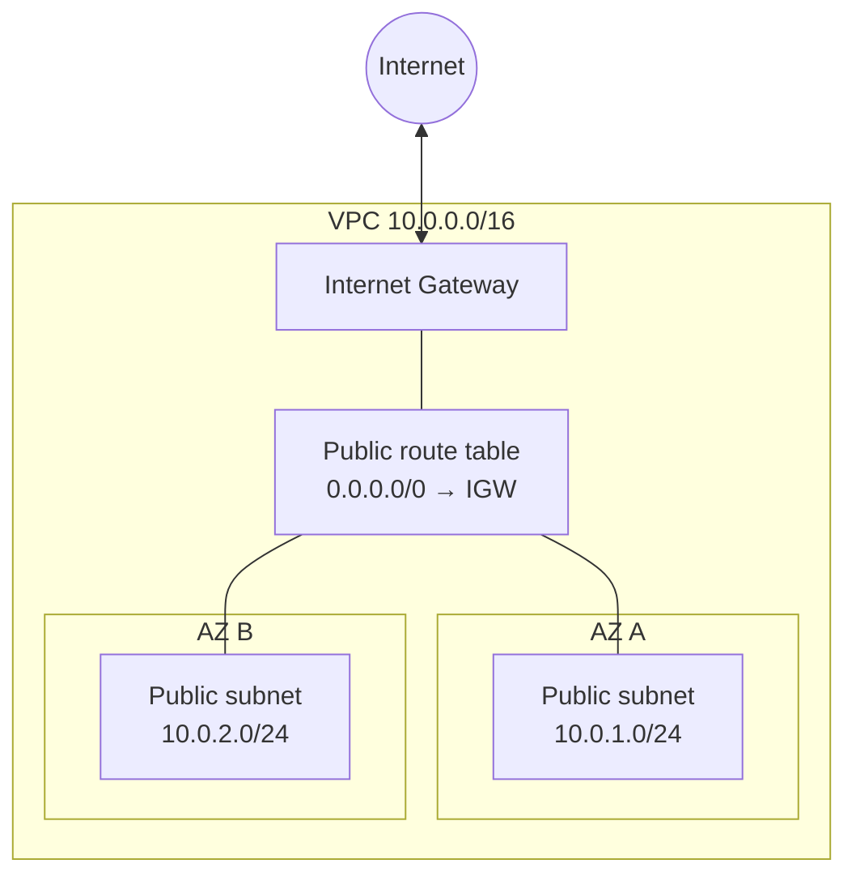

# AWS Highly-Available Full-Stack Deployment with Terraform

Deploying a full-stack web application on AWS using Terraform: custom VPC,
load balancing, auto scaling and a managed database.

🚧 **Work in progress**: the infrastructure is being built step by step.

## Roadmap

- [ ] Networking (VPC, subnets, gateways) — *in progress*
- [ ] Security groups
- [ ] Database (RDS)
- [ ] Backend (EC2, Auto Scaling, Load Balancer)
- [ ] Frontend

## Architecture (current state)

