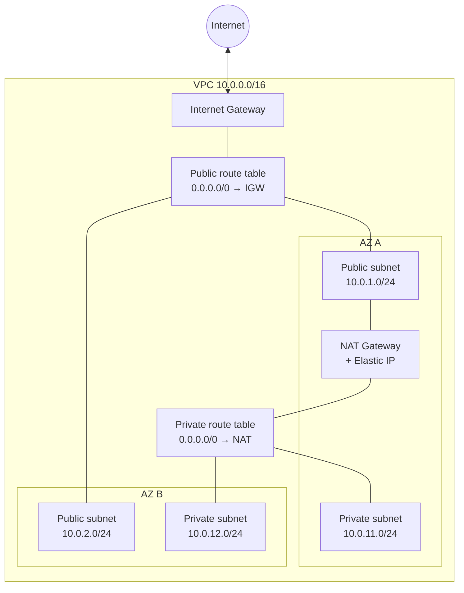

# AWS Highly-Available Full-Stack Deployment with Terraform

Deploying a full-stack web application on AWS using Terraform: custom VPC,
load balancing, auto scaling and a managed database.

🚧 **Work in progress**: the infrastructure is being built step by step.

## Roadmap

- [x] Networking (VPC, subnets, gateways)
- [ ] Security groups
- [ ] Database (RDS)
- [ ] Backend (EC2, Auto Scaling, Load Balancer)
- [ ] Frontend

## Architecture (current state)

## Network design

| Subnet | AZ | CIDR | Routing |
|---|---|---|---|
| Public 1 | A | 10.0.1.0/24 | Internet Gateway |
| Public 2 | B | 10.0.2.0/24 | Internet Gateway |
| Private 1 | A | 10.0.11.0/24 | NAT Gateway (outbound only) |
| Private 2 | B | 10.0.12.0/24 | NAT Gateway (outbound only) |

A single NAT Gateway is used to keep costs low; a production setup would use one per AZ.
